<div align="center">



# That's it

**Convertitore di file drag & drop per macOS**

*Trascina. Scegli. Ecco fatto.*

[](https://github.com/federicosimoni/thats-it/actions/workflows/ci.yml)
[](#licenza)


[English](README.md) · Italiano


</div>

Un piccolo disco di vetro vive sulla tua scrivania. Trascinaci sopra dei file e si apre in un
anello con le conversioni adatte a quei file. Spostati su una, rilascia, e il risultato
compare accanto all'originale. Niente finestre, niente dialoghi, niente upload: tutto gira
sul tuo Mac.

## Caratteristiche

- **Solo ciò che serve.** L'anello mostra solo le conversioni valide per i file trascinati.
  Più file insieme? Vedi le conversioni valide per *tutti*, eseguite in blocco.
- **Nativa.** Scritta in Rust su AppKit e Core Animation, con il vero vetro di macOS,
  SF Symbols, modalità chiara e scura. Niente Electron, niente web view, niente icona nel Dock.
- **Rispetta i tuoi file.** I risultati vengono salvati accanto all'originale come
  `foto.jpg`, `foto (1).jpg`… L'originale non viene mai spostato, sovrascritto o cancellato.
- **Privata.** Nulla esce dal tuo Mac. Le conversioni usano gli strumenti integrati di macOS
  (`sips`, `afconvert`, `textutil`, PDFKit…) e librerie Rust.
- **Estendibile.** Ogni conversione è un piccolo file TOML. Aggiungi le tue senza scrivere
  Rust: vedi [docs/conversions.md](docs/conversions.md) (in inglese).
- **Localizzata.** Inglese e italiano, altre lingue benvenute.

## Cosa converte

| Categoria | Conversioni |
|---|---|
| **Immagini** | PNG, JPG, TIFF, BMP, GIF, WebP (lossless) in tutte le direzioni · HEIC, AVIF → JPG/PNG · SVG → PNG · PNG → icona app (ICNS) · riduci al 25 / 50 / 75% · aumenta al 150 / 200 / 300% · qualità JPG · immagini → PDF |
| **Audio e video** | WAV, AIFF, M4A (AAC), CAF · → MP3¹ · MOV → MP4¹ · comprimi video¹ · video → GIF¹ · estrai audio¹ |
| **Documenti** | DOCX, DOC, RTF, ODT, HTML, TXT in tutte le direzioni · questi → PDF · Markdown → HTML/PDF/DOCX · pagine PDF → PNG |
| **Utility** | comprimi in ZIP · rimuovi i metadati delle foto (EXIF/GPS) senza ricodificare · ottimizza PNG senza perdita |

¹ Richiede [ffmpeg](https://ffmpeg.org): `brew install ffmpeg`. Senza, queste conversioni
semplicemente non compaiono.

## Installazione

Richiede **macOS 13 Ventura o successivo**, su Apple silicon o Intel.

### Passo per passo (consigliato)

1. **Scarica.** Apri l'[ultima release](https://github.com/federicosimoni/thats-it/releases/latest)
   e, sotto **Assets**, fai clic su `Thats-it-<versione>.dmg`.
2. **Copia in Applicazioni.** Fai doppio clic sul `.dmg` scaricato. Nella finestra che si
   apre, trascina **That's it** sulla cartella **Applications**. Poi espelli l'immagine disco
   (il pulsante ⏏ accanto a *That's it* nella barra laterale del Finder) e sposta il `.dmg`
   nel Cestino.
3. **Primo avvio — macOS lo blocca.** Apri **Applicazioni** e fai doppio clic su
   **That's it**. Poiché l'app non è ancora firmata da Apple (vedi sotto), macOS mostra
   *Impossibile aprire "That's it"* (o *Apple non può verificare che non contenga malware*).
   Fai clic su **Fine** (o **OK**). È normale.
4. **Consenti l'apertura una volta.** Apri il **menu Apple ()** → **Impostazioni di Sistema** →
   **Privacy e sicurezza** e scorri fino alla sezione **Sicurezza**. Accanto a
   *L'apertura di "That's it" è stata bloccata…* fai clic su **Apri comunque**, conferma
   con la password o Touch ID, poi fai di nuovo clic su **Apri comunque** nella finestra
   che compare.

   Il pulsante resta visibile per circa un'ora dopo il tentativo bloccato: se non lo vedi,
   ripeti il punto 3.
5. **Fatto.** Il disco di vetro compare in basso a destra sulla scrivania e l'icona nella
   barra dei menu. Non c'è icona nel Dock. Da ora in poi l'app si apre normalmente.
6. **Consenti le notifiche** quando macOS lo chiede, per sapere quando una conversione è
   finita. Se vuoi, attiva **Apri al login** nelle Preferenze (icona nella barra dei menu →
   Preferenze…).

Su macOS 13 Ventura e 14 Sonoma puoi fare i punti 3–4 in un colpo solo: nel Finder fai
**Control-clic** (o clic destro) su *That's it* in Applicazioni, scegli **Apri**, poi di
nuovo **Apri**.

### Con il Terminale

Se preferisci, dopo il punto 2 togli la quarantena del download e apri l'app:

```sh
xattr -dr com.apple.quarantine "/Applications/That's it.app"
open "/Applications/That's it.app"
```

### Con Homebrew

```sh
brew install --cask federicosimoni/tap/thats-it
```

Homebrew scarica lo stesso `.dmg`; il primo avvio richiede comunque il punto 4 (o il
comando `xattr` qui sopra).

### Conversioni video e MP3

Richiedono [ffmpeg](https://ffmpeg.org). Con [Homebrew](https://brew.sh):
`brew install ffmpeg`. Senza, quelle conversioni semplicemente non compaiono.

### Perché l'avviso?

Apple lascia aprire senza avvisi solo le app il cui sviluppatore paga un account Apple
Developer e invia ogni build ad Apple per la notarizzazione. That's it non lo fa ancora.
L'app viene compilata da questo repository con
[GitHub Actions](https://github.com/federicosimoni/thats-it/actions/workflows/release.yml)
e ogni release riporta lo SHA-256 del `.dmg`; puoi confrontarlo con
`shasum -a 256 ~/Downloads/Thats-it-*.dmg`.

### Aggiornare e disinstallare

- **Aggiornare:** scarica il nuovo `.dmg` e sostituisci l'app in Applicazioni (prima
  chiudila dalla barra dei menu). macOS potrebbe chiedere di nuovo il consenso (punto 4).
- **Disinstallare:** chiudi l'app e spostala da Applicazioni al Cestino. Per eliminare
  anche impostazioni e log, cancella
  `~/Library/Application Support/io.github.federicosimoni.thatsit`,
  `~/Library/Logs/io.github.federicosimoni.thatsit` e
  `~/Library/Preferences/io.github.federicosimoni.thatsit.plist`.

## Come si usa

1. Trascina uno o più file dal Finder sul disco della scrivania.
2. Si apre l'anello. Spostati verso una conversione: si illumina.
3. Rilascia. Un anello di avanzamento gira intorno al disco e una notifica ti avvisa alla fine.

**Opzioni:** alcune conversioni finiscono con "…" (qualità JPG, riduci, aumenta,
compressione video, risoluzione PDF). Fermati un attimo su di esse e si apre un secondo
anello con le opzioni; un rilascio veloce usa quella predefinita.

Per annullare, rilascia al centro dell'anello o allontanati. Con più di otto conversioni
l'anello mostra prima le categorie: fermati su una per aprirla, fermati al centro per tornare
indietro.

**Spostare il widget:** tieni premuto **Option** e trascina il disco. Si aggancia a uno di
cinque punti (in alto a sinistra, in alto al centro, in alto a destra, in basso a destra, in
basso a sinistra), sempre abbastanza lontano dai bordi perché l'anello aperto ci stia.
**Option-clic** salta al punto successivo.

**Barra dei menu:** l'icona nella barra dei menu apre le Preferenze (schermo, dimensione del
widget, apertura al login, colore di accento, conversioni visibili, strumenti trovati),
nasconde il widget, annulla una conversione in corso e apre la cartella delle tue conversioni.

Il widget sta sulla scrivania, sotto le finestre. Quando è coperto (da finestre o da un'app
a tutto schermo), inizia a trascinare dei file e tieni premuto per mezzo secondo: compare un
secondo widget **vicino al puntatore**, sopra tutto, che funziona allo stesso modo. Si può
disattivare nelle Preferenze.

## Menu del Finder e Comandi Rapidi

Quando la scrivania è coperta, fai Control-clic sui file nel Finder e scegli
**Converti con That's it…**: le conversioni per quei file compaiono in un menu sotto il
puntatore. Per le automazioni l'app ha una riga di comando che l'azione *Esegui script
shell* di **Comandi Rapidi** può usare, per esempio per creare un'Azione rapida
"Converti in JPG". Vedi [docs/shortcuts.md](docs/shortcuts.md) (in inglese).

## Aggiungere conversioni

Metti un file `.toml` in
`~/Library/Application Support/io.github.federicosimoni.thatsit/conversions/`
(**barra dei menu → Apri cartella conversioni**). Un esempio e il riferimento completo sono
in [README.md](README.md#add-your-own-conversions) e [docs/conversions.md](docs/conversions.md).
I comandi vengono eseguiti direttamente, mai attraverso una shell.

## Contribuire

Nuove conversioni, traduzioni, segnalazioni di bug e correzioni sono tutte benvenute. Parti da
[CONTRIBUTING.md](CONTRIBUTING.md) (in inglese). Le traduzioni si fanno su
[Weblate](docs/translating.md) o direttamente in `locales/`.

## Licenza

A tua scelta, [Apache License, Version 2.0](LICENSE-APACHE) oppure
[licenza MIT](LICENSE-MIT).
