<div align="center">



# That's it

**Drag & drop file converter for macOS**

*Drop it. Pick it. That's it.*

[](https://github.com/federicosimoni/thats-it/actions/workflows/ci.yml)
[](#license)


English · [Italiano](README.it.md)


</div>

A small glass disc lives on your desktop. Drag files onto it and it opens into a ring of the
conversions that make sense for those files. Move onto one, let go, and the result appears
next to the original. No windows, no dialogs, no uploads: everything runs on your Mac.

## Features

- **Only what fits.** The ring shows just the conversions valid for the files you drag.
  Several files at once? You get the conversions valid for *all* of them, run as a batch.
- **Native.** Written in Rust on top of AppKit and Core Animation, with real macOS glass,
  SF Symbols, light and dark mode. No Electron, no web view, no Dock icon.
- **Safe with your files.** Results are written next to the original as `photo.jpg`,
  `photo (1).jpg`… The original is never moved, overwritten or deleted.
- **Private.** Nothing leaves your Mac. Conversions use built-in macOS tools (`sips`,
  `afconvert`, `textutil`, PDFKit…) and Rust libraries.
- **Extensible.** Every conversion is a small TOML file. Add your own without writing
  any Rust: see [docs/conversions.md](docs/conversions.md).
- **Localized.** English and Italian, more welcome.

## What it converts

| Category | Conversions |
|---|---|
| **Images** | PNG, JPG, TIFF, BMP, GIF, WebP (lossless) in any direction · HEIC → JPG/PNG · SVG → PNG · PNG → app icon (ICNS) · shrink to 25 / 50 / 75% · enlarge to 150 / 200 / 300% · JPG quality · images → PDF |
| **Audio & video** | WAV, AIFF, M4A (AAC), CAF · → MP3¹ · MOV → MP4¹ · compress video¹ · video → GIF¹ · extract audio¹ |
| **Documents** | DOCX, DOC, RTF, ODT, HTML, TXT in any direction · those → PDF · Markdown → HTML/PDF/DOCX · PDF pages → PNG |
| **Utilities** | compress to ZIP · remove photo metadata (EXIF/GPS) without re-encoding · optimize PNG losslessly |

¹ Needs [ffmpeg](https://ffmpeg.org): `brew install ffmpeg`. Without it these conversions
are simply hidden.

## Install

Requires **macOS 13 Ventura or later**, on Apple silicon or Intel.

### Step by step (recommended)

1. **Download.** Open the [latest release](https://github.com/federicosimoni/thats-it/releases/latest)
   and, under **Assets**, click `Thats-it-<version>.dmg`.
2. **Copy to Applications.** Double-click the downloaded `.dmg`. In the window that opens,
   drag **That's it** onto the **Applications** folder. Then eject the disk image
   (the ⏏ button next to *That's it* in the Finder sidebar) and move the `.dmg` to the Trash.
3. **First launch — macOS will block it.** Open **Applications** and double-click
   **That's it**. Because the app is not signed by Apple yet (see below), macOS shows
   *"That's it" Not Opened* (or *cannot be opened because Apple cannot check it for
   malicious software*). Click **Done** (or **OK**). This is expected.
4. **Allow it once.** Open the **Apple menu ()** → **System Settings** → **Privacy & Security** and scroll
   down to the **Security** section. Next to *"That's it" was blocked to protect your Mac*,
   click **Open Anyway**, confirm with your password or Touch ID, then click **Open Anyway**
   again in the dialog that appears.

   The button only shows up for about an hour after the blocked launch: if you don't see
   it, repeat step 3.
5. **Done.** The glass disc appears in the bottom-right corner of your desktop and the tray
   icon in the menu bar. There is no Dock icon. From now on the app opens normally.
6. **Allow notifications** when macOS asks, to be told when a conversion is finished.
   Optionally, turn on **Open at login** in Preferences (menu bar icon → Preferences…).

On macOS 13 Ventura and 14 Sonoma you can also do steps 3–4 in one go: in the Finder,
**Control-click** (or right-click) *That's it* in Applications, choose **Open**, then
**Open** again.

### With the Terminal

If you prefer, after step 2 remove the download quarantine and open the app:

```sh
xattr -dr com.apple.quarantine "/Applications/That's it.app"
open "/Applications/That's it.app"
```

### With Homebrew

```sh
brew install --cask federicosimoni/tap/thats-it
```

Homebrew downloads the same `.dmg`; the first launch still needs step 4 (or the `xattr`
command above).

### Video and MP3 conversions

They need [ffmpeg](https://ffmpeg.org). With [Homebrew](https://brew.sh):
`brew install ffmpeg`. Without it, those conversions are simply hidden.

### Why the warning?

Apple only lets apps open without a warning if their developer pays for an Apple
Developer account and sends every build to Apple for notarization. That's it does not do
that yet. The app is built from this repository by
[GitHub Actions](https://github.com/federicosimoni/thats-it/actions/workflows/release.yml),
and each release lists the SHA-256 of the `.dmg`; you can compare it with
`shasum -a 256 ~/Downloads/Thats-it-*.dmg`.

### Update and uninstall

- **Update:** download the new `.dmg` and replace the app in Applications (quit it first
  from the menu bar). macOS may ask you to allow it again (step 4).
- **Uninstall:** quit the app and move it from Applications to the Trash. To remove its
  settings and logs too, delete
  `~/Library/Application Support/io.github.federicosimoni.thatsit`,
  `~/Library/Logs/io.github.federicosimoni.thatsit` and
  `~/Library/Preferences/io.github.federicosimoni.thatsit.plist`.

## How to use it

1. Drag one or more files from the Finder onto the disc on your desktop.
2. The ring opens. Move towards a conversion; it lights up.
3. Let go. A progress ring runs around the disc and a notification tells you when it is done.

**Options:** some conversions end with "…" (JPG quality, shrink, enlarge, video
compression, PDF resolution). Rest on them for a moment and a second ring with the options opens; a quick
drop uses the default.

To cancel, let go in the middle of the ring or drag away. When there are more than eight
conversions, the ring shows categories first: rest on one to open it, rest on the centre to
go back.

**Moving the widget:** hold **Option** and drag the disc. It snaps to one of five places
(top left, top centre, top right, bottom right, bottom left), always far enough from the
edges for the open ring to fit. **Option-click** jumps to the next place.

**Menu bar:** the tray icon in the menu bar opens Preferences (screen, widget size, open
at login, accent color, which conversions appear, detected tools), hides the widget,
cancels a running conversion and opens the folder for your own conversions.

The widget sits on the desktop, under your windows. When it is covered (by windows or a
full-screen app), start dragging files and keep the button pressed for half a second: a
second widget appears **next to the pointer**, above everything, and works the same way.
This can be turned off in Preferences.

## Finder menu and Shortcuts

When the desktop is covered, Control-click files in the Finder and choose
**Convert with That's it…**: the conversions for those files appear in a menu at the
pointer. For automations, the app has a command line that the **Shortcuts** action
*Run Shell Script* can call, e.g. to build a "Convert to JPG" Quick Action. See
[docs/shortcuts.md](docs/shortcuts.md).

## Add your own conversions

Drop a `.toml` file into
`~/Library/Application Support/io.github.federicosimoni.thatsit/conversions/`
(**menu bar → Open Conversions Folder**):

```toml
schema     = 1
id         = "image.to-avif"
category   = "images"
icon       = "photo"
accepts    = ["public.jpeg", "public.png"]
output_ext = "avif"
requires   = ["avifenc"]

[label]
en = "Convert to AVIF"
it = "Converti in AVIF"

[[steps]]
cmd = ["avifenc", "{input}", "{output}"]
```

Commands run directly, never through a shell. The full reference is in
[docs/conversions.md](docs/conversions.md).

## Contributing

New conversions, translations, bug reports and fixes are all welcome. Start with
[CONTRIBUTING.md](CONTRIBUTING.md). Translations are done in [Weblate](docs/translating.md)
or directly in `locales/`.

## Building from source

```sh
cargo run -p thatsit-app            # run the widget from the terminal
cargo xtask bundle --native         # build target/bundle/That's it.app
```

See [docs/releasing.md](docs/releasing.md) and [docs/architecture.md](docs/architecture.md).

## License

Licensed under either of [Apache License, Version 2.0](LICENSE-APACHE) or
[MIT license](LICENSE-MIT) at your option. Unless you explicitly state otherwise, any
contribution intentionally submitted for inclusion in this project, as defined in the
Apache-2.0 license, shall be dual licensed as above, without any additional terms or
conditions.
